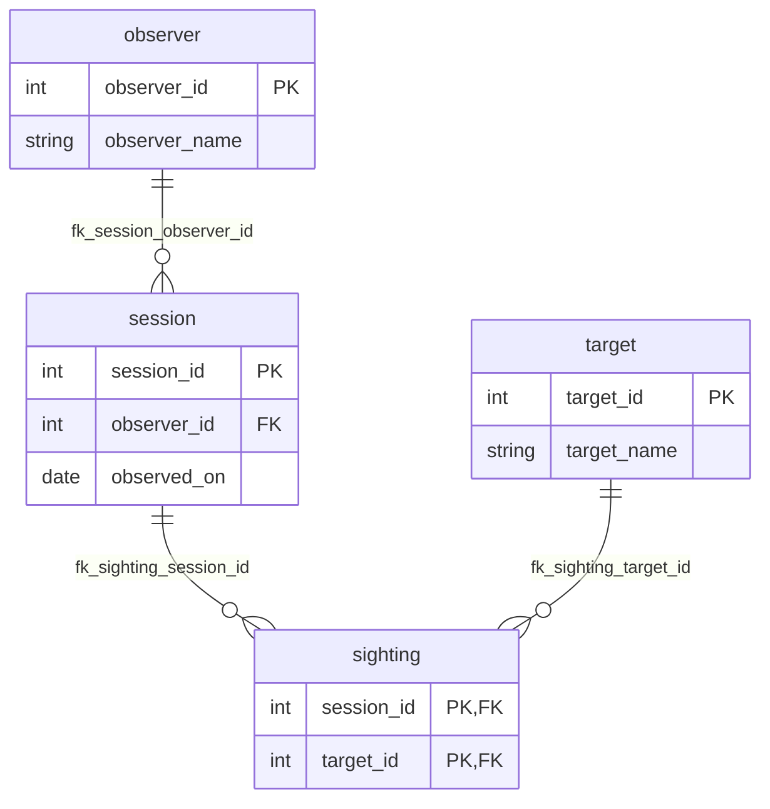

# CMSC 127 Lab Starter

This repository holds the files for your database labs. Keep your work in this repository. The instructor grades the files that differ from the published starter.

## Set Up Python and PostgreSQL

Install Python 3.15 or newer and PostgreSQL. Start the PostgreSQL server before you run the checks.

Create a Python environment and install the listed packages:

```bash
python -m venv .venv
source .venv/bin/activate
python -m pip install -r requirements.txt
```

In Git Bash on Windows, activate the environment with:

```bash
source .venv/Scripts/activate
```

Set `CMSC127_DATABASE_URL` in your shell. Use a local database role that can create and drop databases. The runner uses this URL to create a separate database for each run.

```bash
export CMSC127_DATABASE_URL='postgresql://your_user@127.0.0.1:5432/your_database'
```

Add a password to the URL only in your local shell when your server needs one. Do not save a password in this repository.

## Run the Checks

Run stage 1 with:

```bash
./check.sh 1
```

Run stage 2 with:

```bash
./check.sh 2
```

Stage 2 includes the checks from stage 1. The runner downloads the pinned version the first time. Later runs use the local copy and need no network access.

Run the harness self-tests with:

```bash
./check.sh --self-test
```

Self-tests use a separate temporary database. The runner writes the latest result to `.cmsc127/last-run.json`. Git ignores this file. Each result lists its case, status, expected value, actual value, and any difference.

## Migrations and Data

Put schema changes in `migrations/`. Each migration file needs a four-digit number, an underscore, and a lowercase description, such as `0001_create_student.sql`. Start at `0001` and do not skip a number. The runner applies these files in sorted order to a new database.

Put the data loader in `load.sql`. The runner calls `./run prepare` after it applies migrations. The command runs this SQL file without changing your source files.

The pair command is `./run`. The runner calls it with `prepare`, `backup`, `restore`, or a case file path. The connection helper runs one SQL file and prints its columns and rows as JSON.

## Cases and Results

The runner reads `cases/manifest.json`. The manifest lists each case, its stage, its group, and its kind. A case file has a `.expected` JSON file beside it. An optional `.exit` file contains the expected process exit code. Every case file must appear in the manifest.

Result files use JSON objects with a `columns` list and a `rows` list. Put JSON `null` in a cell to test SQL `NULL`. Numbers compare by value, so `1`, `1.0`, and `1.00` match. Column names and their order always match. Row order matches by default. Set `ordered` to `false` when the result has no required row order. The runner compares duplicate rows too.

The six case kinds test command output, the ERD, rejected SQL, stored state, two ordered database sessions, and SQL reports. A skipped check prints `SKIP` with a reason. A skip does not count as a pass. A form error stops scoring and reports its line and column.

The runner prints each result, a count for each group, and one final count. It exits with a non-zero code when a check fails. The invariant checks run after the cases. They test SQL reports, normal-form keys, required SQL features, indexes, backup and restore, protected files, written sections, and Git contribution history. The contribution table is evidence for the instructor. It does not set a score.

## Write the ERD

An entity-relationship diagram (ERD) shows tables and their relationships. Edit the ERD block in this README to match your schema. The runner compares table names, column names, primary keys, foreign keys, and relationship endpoints.


